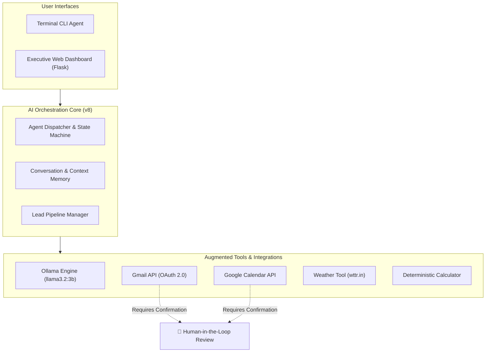

# 🚀 AI Sales Copilot

> **An Autonomous, Local-First AI Sales Assistant & Workflow Automation Engine**  
> *Seamlessly orchestrating lead qualification, Gmail follow-ups, Google Calendar booking, and real-time tool calling with strict Human-in-the-Loop safeguards.*

[](https://www.python.org/)
[-orange.svg)](https://ollama.com/)
[](https://developers.google.com/)
[](https://flask.palletsprojects.com/)
[](LICENSE)

---

## 📌 Overview

**AI Sales Copilot** is an enterprise-grade AI agent designed to automate repetitive sales operations while keeping sensitive data secure and under human control. 

By combining local LLM reasoning (via **Ollama**) with direct **Gmail** and **Google Calendar** integrations, the Copilot triages incoming leads, determines transparent action priorities, drafts contextually grounded outreach emails, and books meetings directly into your schedule.

---

## ✨ Key Features

- **🧠 Local-First LLM Intelligence**: Powered by Ollama (`llama3.2:3b`). Keeps client communications, lead records, and proprietary data completely local and private without leaking data to third-party APIs.
- **📬 Autonomous Follow-up Drafting (Gmail API)**: Generates highly personalized email drafts grounded strictly in verified product knowledge, with interactive previews before sending.
- **📅 Smart Meeting Scheduling (Google Calendar API)**: Automates appointment booking with conflict checking and timezone awareness.
- **📊 Lead Pipeline & Triage Dashboard**: Tracks full lead lifecycles (`New`, `Contacted`, `Qualified`, `Meeting Scheduled`, `Won`, `Lost`) with automated follow-up scheduling.
- **🛡️ Human-in-the-Loop Safeguards**: Built on the principle that AI assists but humans decide. No external email is sent or meeting created without explicit user confirmation.
- **🌦️ Contextual Tool Calling**:
  - **Weather Agent**: Gathers real-time weather data for context-aware field meeting preparation.
  - **Deterministic Calculator**: Evaluates custom volume quotes and pricing with exact arithmetic validation.
- **💻 Dual User Interfaces**:
  - **Executive Web UI (`sales_copilot_web.py`)**: Sleek, modern, dark-mode dashboard with real-time status and quick actions.
  - **Interactive CLI (`sales_agent_unified_v8.py`)**: Fast, lightweight command-line workspace for terminal users.

---

## 🏗️ System Architecture



---

## 📁 Repository Structure

```text
├── sales_copilot_web.py          # Executive Flask Web Application
├── sales_agent_unified_v8.py     # Production Unified Multi-Agent Core Engine
├── sales_agent.py                # Base Sales Automation Agent
├── email_agent.py                # Gmail API Connector & Email Composition Engine
├── weather_agent.py              # Real-Time Contextual Weather Tool
├── app.py                        # Minimalist Prototype & Tool Calling Demo
├── oauth_diagnostic.py           # Google Workspace OAuth Verification Suite
├── calendar_auth_test.py         # Google Calendar OAuth & Scope Tester
├── gmail_quickstart_test.py      # Gmail API Quickstart Test Script
├── requirements.txt              # Production Dependency Specifications
├── .gitignore                    # Robust Credential & Secret Leak Protection
└── README.md                     # Comprehensive Project Documentation
```

---

## 🚀 Getting Started

### 1. Prerequisites
- **Python 3.10+**
- **Ollama**: Download and install from [ollama.com](https://ollama.com)
- **Google Cloud Console**: OAuth 2.0 Desktop Client credentials with Gmail & Google Calendar APIs enabled.

### 2. Installation & Setup

1. **Clone the repository:**
   ```bash
   git clone https://github.com/Naveen9715/sales-copilot.git
   cd sales-copilot
   ```

2. **Create a virtual environment:**
   ```powershell
   python -m venv .venv
   .\.venv\Scripts\Activate.ps1
   ```

3. **Install dependencies:**
   ```bash
   pip install -r requirements.txt
   ```

4. **Initialize Ollama model:**
   ```bash
   ollama pull llama3.2:3b
   ```

5. **Configure Google OAuth:**
   - Download your Google OAuth client secret JSON from Google Cloud Console.
   - Rename it to `credentials.json` and place it in the project root directory.

---

## 💡 Usage

### Starting the Web Dashboard:
```bash
python sales_copilot_web.py
```
Open your browser at `http://127.0.0.1:5000` to access the Executive Sales Dashboard.

### Running the CLI Agent:
```bash
python sales_agent_unified_v8.py
```

#### Available CLI Commands:
| Command | Action |
|---|---|
| `add lead` | Capture a new prospect interactively |
| `list leads` | Display all leads, current stage, and follow-up timeline |
| `sales dashboard` | Overview of open opportunities and urgent follow-ups |
| `follow-up queue` | View prioritized list of leads requiring outreach |
| `sales automation` | Step-by-step interactive batch outreach with human approval |
| `email lead` | Draft a personalized email using Ollama & Gmail API |
| `calculate <expr>` | Compute pricing quotes accurately |

---

## 🔒 Security & Privacy

- **Zero Secret Commits**: Sensitive files (`credentials.json`, `token.json`, `.env`, client databases) are strictly excluded via `.gitignore`.
- **Local Data Residence**: Client conversations and lead details are stored locally on machine storage, ensuring full privacy and compliance with data handling standards.
- **No Unattended Execution**: The AI never sends communications or makes calendar modifications without explicit human preview and authorization.

---

## 👨‍💻 Author

**Naveen**  
- **GitHub**: [@Naveen9715](https://github.com/Naveen9715)  
- **Email**: [naveen2742005@gmail.com](mailto:naveen2742005@gmail.com)